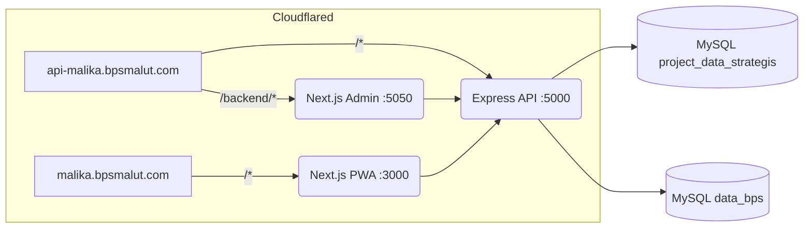
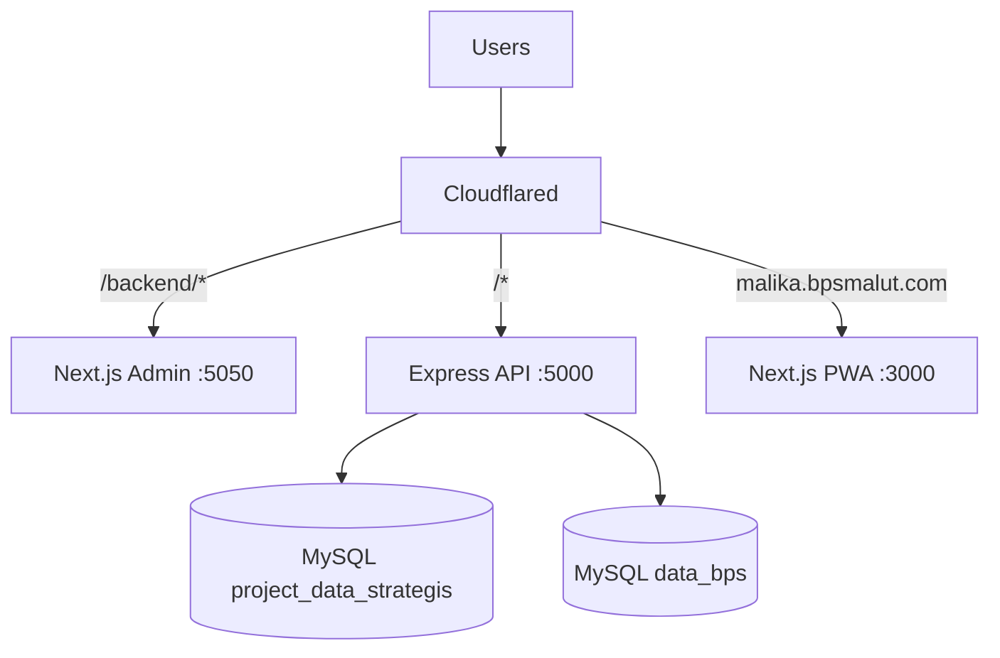

# MALIKA — Maluku Utara Analytics & Insights for Knowledge Advancement

PWA + Admin Panel + Chat AI assistant untuk visualisasi data BPS Maluku Utara.

> Internal-use repository milik BPS Provinsi Maluku Utara.

## Quick start

```bash
# 1. Install dependencies (backend + admin + frontend)
cd backend && npm install
cd ../backend/admin && npm install
cd ../../frontend && npm install

# 2. Configure environment
cp backend/.env.example backend/.env
# Edit backend/.env — fill in real DB creds + API keys

# 3. Setup MySQL databases (manual schema):
#    - project_data_strategis  (registry, metadata, indicator_meta)
#    - data_bps                (BPS replica, indikator_NNN tables)

# 4. Start LLM proxy (separate process on :3031)
#    See /opt/openclaw/malika-llm-proxy.config.js

# 5. Start app via PM2
pm2 start ecosystem.config.js
```

## Documentation entry points

- **`PROJECT_COMPREHENSIVE_DOC.md`** — Full architecture, operations, runbooks
- **`REFERENCE.md`** — Quick lookups (commands, paths, ports, account list)
- **`docs/ARCHITECTURE.md`** — System design diagrams
- **`docs/workspace/`** — Per-aspect change logs (backend, frontend, admin, chat-pipeline, AI/LLM, database, infra)

## Architecture overview

## Diagrams (Mermaid)

### System Architecture


### Deployment Topology


See docs/ARCHITECTURE.md for full details.
