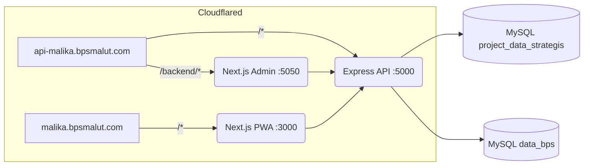
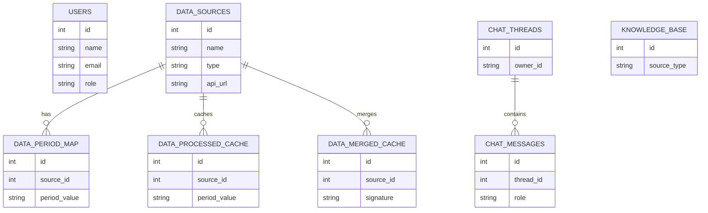
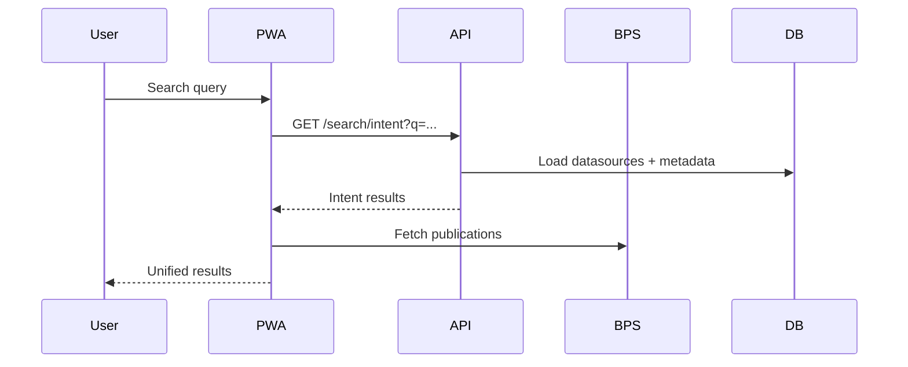
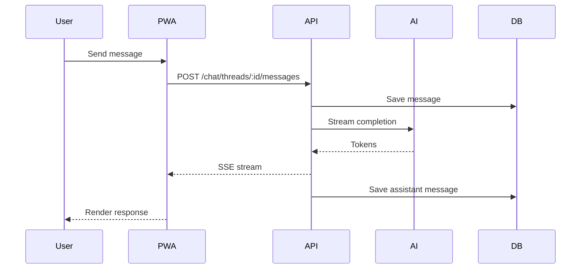
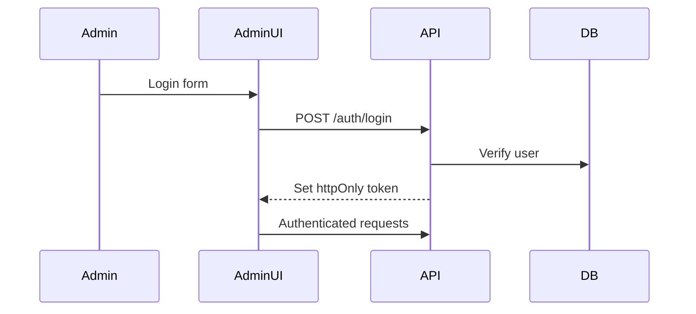
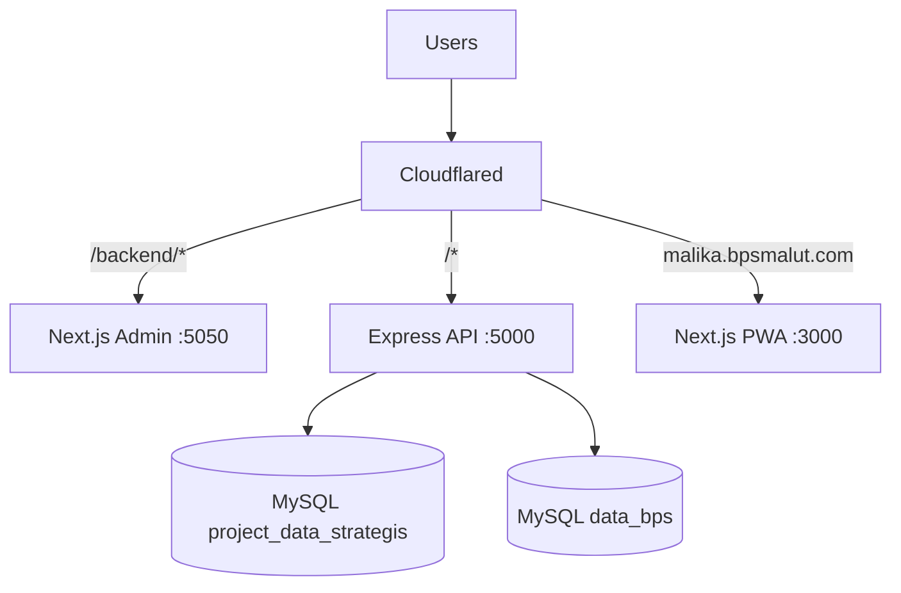

# Architecture Guide

## System Overview
The system consists of three services:
- Backend API (Express) on port 5000
- Admin Panel (Next.js) on port 5050 (basePath /backend)
- Public PWA (Next.js) on port 3000

Cloudflared routes:
- api-malika.bpsmalut.com/backend/* → Admin Panel
- api-malika.bpsmalut.com/* → Backend API
- malika.bpsmalut.com/* → Public PWA

## Diagrams

### System Architecture

### Database ERD

## Data Stores
- Primary MySQL: project_data_strategis
- Replica MySQL: data_bps (best-effort sync)

## Core Flows
### Search Flow
1. PWA calls /api/search
2. Backend /search/intent ranks datasources
3. PWA merges with BPS publications

### Data Fetch Flow
1. PWA calls /api/data-preview
2. Backend dynamic controller resolves priority:
   - data_bps table
   - ProcessedCache
   - Upstream API

### Chat Flow
1. PWA sends /chat/threads/:id/messages
2. Backend streams via SSE /chat/threads/:id/stream
3. Responses include UI metadata for rendering

## Services and Ownership
- Backend services: backend/src/services
- Controllers: backend/src/controllers
- Routes: backend/src/routes
- Shared utils: backend/src/utils

## Security Model
- JWT stored in httpOnly cookie (token)
- CSRF token required for admin writes
- Rate limiting per endpoint
- Admin-only routes require role=admin

## Observability
- Structured logging with request IDs
- Metrics at /metrics (Prometheus)
- Health check at /health

## Deployment Notes
- PM2 manages processes via ecosystem.config.js
- Production uses cluster mode for backend, admin-prod, pwa-prod

