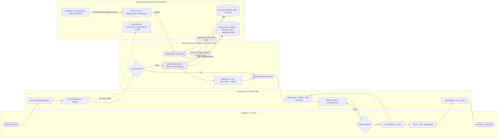
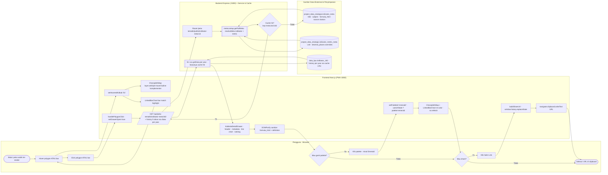

# Peta Tematik MALIKA — Flow Pembuatan & Penyajian (4-Swimlane, ISO 5807)

> **Tanggal**: 2026-05-18 · **Versi**: 1.0 · **Cakupan**: dari pemanggilan **BPS Webservice API publik** sampai polygon ter-render di Leaflet dan user berinteraksi (hover · click · share).
> **Stack**: Next.js 14 (PWA + admin) · Express 4 (backend) · MariaDB 11.8 · Leaflet 1.9.4 · BPS Webservice API.
> **Companion docs**: [`ARSITEKTUR_LENGKAP.md`](./ARSITEKTUR_LENGKAP.md), [`MIGRASI_METABASE_KE_LEAFLET.md`](./MIGRASI_METABASE_KE_LEAFLET.md).

Dokumen ini menyusun **lima cross-functional flowchart** ber-swimlane empat kolom mengikuti gaya BPMN dengan simbol ISO 5807:1985. Diagram disusun supaya seluruh perjalanan data peta tematik — dari sumber paling hulu (BPS Webservice API) sampai interaksi paling hilir (klik polygon di browser pengguna) — dapat dibaca berurutan tanpa harus menebak.

Setiap diagram diiringi narasi 1–2 paragraf yang menjelaskan komponen utama, arah data, dan alasan keputusan rancangan. Bila dokumen ini bertabrakan dengan dokumen lain di repo, **kode aktual adalah sumber kebenaran** dan inkonsistensi yang terdeteksi dicatat di §9.

---

## Daftar Isi

1. [Aktor dan Swimlane](#1-aktor-dan-swimlane)
2. [Konvensi Simbol (ISO 5807)](#2-konvensi-simbol-iso-5807)
3. [Diagram 1 — Master: Mulai sampai Selesai](#3-diagram-1--master-mulai-sampai-selesai)
4. [Diagram 2 — ETL: BPS Webservice API → `data_bps.indikator_NNN`](#4-diagram-2--etl-bps-webservice-api--data_bpsindikator_nnn)
5. [Diagram 3 — Discovery: Boot scan eligibility + indikator-list](#5-diagram-3--discovery-boot-scan-eligibility--indikator-list)
6. [Diagram 4 — Render: pilih indikator → choropleth Leaflet](#6-diagram-4--render-pilih-indikator--choropleth-leaflet)
7. [Diagram 5 — Interaksi: hover linked, drawer detail, palette, share](#7-diagram-5--interaksi-hover-linked-drawer-detail-palette-share)
8. [Tabel Ringkasan](#8-tabel-ringkasan)
9. [Catatan Inkonsistensi dengan Dokumen Lain](#9-catatan-inkonsistensi-dengan-dokumen-lain)
10. [Referensi Kode Sumber](#10-referensi-kode-sumber)

---

## 1. Aktor dan Swimlane

Empat kolom (swimlane) yang konsisten dipakai di kelima diagram:

| Kolom | Aktor / Komponen | Catatan |
|---|---|---|
| **Kolom 1 — Pengguna · Browser** | End-user (publik atau admin BPS) + window browser yang menjalankan JS Leaflet | Aksi: input filter, hover, click, share URL. Render polygon dilakukan di sini (Leaflet client-side). |
| **Kolom 2 — Frontend Next.js (PWA :6060)** | `page.tsx` server wrapper + `PetaTematikClient.tsx` client component + `frontend/src/app/api/peta-tematik/*` Next.js route handlers (proxy) | Tidak ada React Query di PWA peta-tematik — state pakai `useState` + `useUrlState`. Proxy route selalu `cache: "no-store"` (backend yang cache). |
| **Kolom 3 — Backend Express (:5000) + Service & Cache** | `peta-tematik.controller.js` + `services/petaTematik/*` (orchestrator, eligibilityScanner, regionMap, categorization, metadataLookup, cache LRU) + middleware rate-limit | Public mount (PWA): `/peta-tematik/public` rate-limit 120 req/min, no auth (`app.js:103`). Admin mount: `/peta-tematik` + authMiddleware + requireAdmin + audit log (`app.js:198`). |
| **Kolom 4 — Sumber Data Eksternal & Penyimpanan (heterogen)** | (a) BPS Webservice API publik `webapi.bps.go.id`, (b) MariaDB `data_bps` (replica), (c) MariaDB `project_data_strategis` (metadata + embedding 768d), (d) file `peta_kabko_malut.geojson` 11 MB, (e) Scheduler/cron automation runner | **Aturan label**: setiap simpul di kolom ini wajib diberi prefiks aktor pada labelnya — `BPS API: …`, `data_bps: …`, `project_data_strategis: …`, `GeoJSON file: …`, `Scheduler: …` — supaya pembaca bisa membedakan aktor heterogen tanpa membaca konteks. |

> **Catatan penting Maluku Utara**: ada 10 kab/kota (8 kabupaten + 2 kota: Halmahera Barat/Tengah/Utara/Selatan/Timur, Kepulauan Sula, Pulau Morotai, Pulau Taliabu, Ternate, Tidore Kepulauan). Provinsi total (`"Maluku Utara"` di `dim_value`) sengaja **tidak** dipetakan ke polygon — hanya dipakai di endpoint summary.

---

## 2. Konvensi Simbol (ISO 5807)

| ISO 5807 | Mermaid syntax | Pemakaian di dokumen ini |
|---|---|---|
| Terminator (oval) | `id([Mulai])` / `id([Selesai])` | Awal/akhir alur per diagram. |
| Proses (rectangle) | `id[Aksi]` | Komputasi atau langkah biasa. |
| Keputusan (rhombus) | `id{Pertanyaan?}` | **Wajib** punya cabang Ya/Tidak yang ter-resolve (boleh kembali ke simpul sebelumnya untuk retry/koreksi). |
| Masukan/Keluaran (parallelogram) | `id[/Input atau Output/]` | Payload yang melintasi swimlane (request, response, payload UI). |
| Penyimpanan data (cylinder) | `id[(nama_tabel)]` | Tabel DB atau file storage (GeoJSON). |
| Subrutin (predefined process) | `id[[Aksi penting]]` | Pemanggilan fungsi service yang punya logika non-trivial (mis. `getOrCompute`, `scanEligibility`). |

Anotasi tambahan: simpul yang mengubah status tabel utama diberi `(status: X → Y)`. Untuk peta tematik fitur ini paling relevan untuk cache LRU (`MISS → HIT`) dan tabel indikator (`absent → present`) saat ETL pertama.

---

## 3. Diagram 1 — Master: Mulai sampai Selesai



### Narasi Diagram 1

Diagram Master memetakan dua alur yang **paralel dan asinkron** dalam siklus hidup fitur. Alur **hulu** (`Scheduler → BPS API → data_bps`) hanya aktif kalau `AUTOMATION_ENABLED=true` di env (`scheduler.service.js:125`); kalau mati, tabel `indikator_NNN` di `data_bps` hanya bertumbuh lewat trigger manual admin via `/automation/run/:id`. Alur **hilir** (User → PWA → Backend → DB) berjalan terus-menerus dan menjadi *hot path* setiap request peta tematik: PWA selalu pakai endpoint `/peta-tematik/public/*` (no auth, rate-limit 120/min), backend cek cache LRU dulu (`cache:` key prefix), miss → query `data_bps` + (paralel) `project_data_strategis`, hit → langsung respons.

Empat keputusan kunci yang ditangkap di Master: (a) `Cache hit?` di backend menentukan latensi 5 ms vs 100–300 ms; (b) `Map ter-render?` di browser menentukan apakah user lanjut interaksi atau lihat skeleton; (c) `AUTOMATION_ENABLED` (di kolom 4) menentukan apakah cabang ETL hulu pernah berjalan di environment tersebut; (d) `useUrlState` (di kolom 2) memastikan setiap state (`indikator`, `year`, `month`, `metric`, `bin`, `palette`) ditulis ke URL via `window.history.replaceState` sehingga URL akhir di `Selesai · share URL` 100% reproducible.

---

## 4. Diagram 2 — ETL: BPS Webservice API → `data_bps.indikator_NNN`

```mermaid
flowchart LR
    subgraph LANE1 ["Pengguna · Browser"]
        direction TB
        U1([Mulai: admin trigger manual ATAU scheduler tick])
        U2{Admin trigger?}
        U3([Selesai: data fresh di tabel])
    end

    subgraph LANE2 ["Frontend Next.js (PWA :6060)"]
        direction TB
        F1[Admin panel · /automation page]
        F2[/POST /automation/run/:sourceId/]
    end

    subgraph LANE3 ["Backend Express (:5000) + Service & Cache"]
        direction TB
        B1[[automation/scheduler.service.startAutomationScheduler]]
        B2{Mode = interval ATAU daily?}
        B3[[automationRunner.runOne sourceId]]
        B4[[applyWebApiKeyPlaceholder: substitusi BPS_API_KEY]]
        B5[[period/fetchByTh + fetchAvailable + bpsMetadata/extractors/dynamic]]
        B6{Response BPS OK?}
        B7[[replicateMergedToIndicatorTableBps]]
        B8[[ensureIndicatorTable: CREATE TABLE IF NOT EXISTS]]
        B9[Compute dim_hash · signature · normalisasi]
    end

    subgraph LANE4 ["Sumber Data Eksternal & Penyimpanan"]
        direction TB
        S1[Scheduler: tick interval atau daily_at HH:MM]
        S2[BPS API: GET /v1/api/list/model/data/var/{var}/th/{th}/key/{API_KEY}]
        S3[BPS API: GET /v1/api/dataexim/ · /v1/api/pressrelease/]
        S4[(project_data_strategis.AutomationConfig · scheduler state)]
        S5[(data_bps.indikator_NNN · status: absent → present)]
        S6[(project_data_strategis.indicator_meta · UPSERT)]
        S7[(project_data_strategis.retrieval_chunks · embedding 768d)]
    end

    U1 --> U2
    U2 -- Ya --> F1
    U2 -- Tidak --> S1
    F1 --> F2
    F2 --> B3

    S1 --> B1
    B1 --> S4
    B1 --> B2
    B2 -- interval --> B3
    B2 -- daily --> B3
    B3 --> B4
    B4 --> B5
    B5 --> S2
    B5 --> S3
    S2 --> B6
    S3 --> B6
    B6 -- Tidak --> B3
    B6 -- Ya --> B7
    B7 --> B8
    B8 --> S5
    B7 --> B9
    B9 -- ON DUPLICATE KEY UPDATE --> S5
    B7 -- persistMetadata --> S6
    S6 -- 06:30 WIT resync --> S7
    S5 --> U3
```

### Narasi Diagram 2

Alur ETL menyalin data BPS dari sumber otoritatif (`webapi.bps.go.id`) ke replika lokal `data_bps.indikator_NNN`. Ada **dua pintu masuk**: (a) admin trigger manual `POST /automation/run/:sourceId` via halaman admin, dan (b) scheduler otomatis (`scheduler.service.startAutomationScheduler` di `server.js:151`) yang aktif kalau `AUTOMATION_ENABLED=true`. Mode scheduler dibaca dari `AutomationConfig` di DB: bisa `interval` (jalan tiap N menit) atau `daily` (jalan sekali pada `runHour:runMinute`). Eksekusi inti ada di `automationRunner.runOne()`: substitusi placeholder API key (`[WebAPI_KEY]`), panggil BPS endpoint (`period/fetchByTh.service` untuk seri tahun/triwulan/bulan, `exim/eximSeed` untuk EXIM, `pressrelease/*` untuk press release), parse via `bpsMetadata/extractors/dynamic.extractor`.

Penulisan ke DB dilakukan oleh `replicateMergedToIndicatorTableBps()` di `services/replication/indicatorTableBps.service.js:337`: `ensureIndicatorTable()` (CREATE TABLE IF NOT EXISTS dengan UNIQUE KEY `(th_id, month_no, dim_hash, metric)`), hitung `dim_hash` + `signature` untuk deduplikasi row dimensional, lalu INSERT dengan `ON DUPLICATE KEY UPDATE` — idempotent. Metadata indikator (title, source citation, subject) di-UPSERT ke `indicator_meta` di DB primer; embedding 768-dim ke `retrieval_chunks` di-resync oleh scheduler terpisah (`indicatorMetaScheduler.service` jadwal harian ~06:30 WIT, idempotent). Bila response BPS gagal, decision `Response BPS OK?` mengembalikan eksekusi ke `runOne` untuk retry pada tick scheduler berikut — tidak ada retry loop sinkron yang ketat.

---

## 5. Diagram 3 — Discovery: Boot scan eligibility + `indikator-list`

```mermaid
flowchart LR
    subgraph LANE1 ["Pengguna · Browser"]
        direction TB
        U1([Mulai: load halaman /peta-tematik])
        U2[/Picker indikator terisi/]
        U3([Selesai: user siap pilih])
    end

    subgraph LANE2 ["Frontend Next.js (PWA :6060)"]
        direction TB
        F1[PetaTematikClient mount · useEffect 1]
        F2[/GET /api/peta-tematik/indikator-list/]
        F3[Route handler · cache: no-store · proxy ke backend]
        F4[/Response: kategori + 204 indikator/]
        F5[Build picker bertingkat · kategori → indikator]
    end

    subgraph LANE3 ["Backend Express (:5000) + Service & Cache"]
        direction TB
        B0[[server.js boot · initIndikatorList lazy init]]
        B1[Route: GET /peta-tematik/public/indikator-list]
        B2[ctrl.getIndikatorList · withGuard]
        B3[[svc.getIndikatorList]]
        B4{Cache LRU hit?<br/>key=ind:list}
        B5{initPromise sudah jalan?}
        B6[[scanEligibility 311 tabel]]
        B7[[buildIndikatorList · classify 8 kategori]]
        B8[[enrichListWithMetadata · bulk lookup]]
        B9[cache.set TTL 1 jam<br/>(status: MISS → HIT)]
        B10[/Response JSON/]
    end

    subgraph LANE4 ["Sumber Data Eksternal & Penyimpanan"]
        direction TB
        S1[(data_bps.information_schema.TABLES · LIKE indikator_%)]
        S2[(data_bps.indikator_NNN · COUNT WHERE dim_value IN 10 kab/kota AND value IS NOT NULL)]
        S3[Excluded list: indikator_418 · 159 · 160]
        S4[(project_data_strategis.indicator_meta · bulk SELECT by source_id)]
    end

    U1 --> F1
    F1 --> F2
    F2 --> F3
    F3 --> B1
    B1 --> B2
    B2 --> B3
    B3 --> B4
    B4 -- Ya --> B10
    B4 -- Tidak --> B5
    B5 -- Ya --> B5
    B5 -- Tidak --> B6
    B6 --> S1
    S1 --> B6
    B6 -- per tabel · skip blacklist --> S3
    B6 --> S2
    S2 --> B6
    B6 --> B7
    B7 --> B8
    B8 --> S4
    S4 --> B8
    B8 --> B9
    B9 --> B10
    B10 --> F4
    F4 --> F5
    F5 --> U2
    U2 --> U3

    B0 -. "warm-up saat boot pds-backend (best-effort)" .-> B3
```

### Narasi Diagram 3

Diagram Discovery menggambarkan satu kali jalur yang **mahal di awal, murah berikutnya**: scan kelayakan 311 tabel BPS + bulk metadata enrichment. Ada dua entry point: (a) **warm-up boot** dari `server.js:158` (`initIndikatorList()` dipanggil best-effort saat `pds-backend` start, jadi request pertama post-restart sudah hit cache), dan (b) **request user** yang pertama kalau cache miss/expire. Decision `initPromise sudah jalan?` adalah pengaman dedup: kalau dua request masuk bersamaan sebelum cache terisi, hanya satu yang melakukan scan; sisanya `await` Promise yang sama. Ini disengaja karena `scanEligibility()` query `information_schema` + COUNT per tabel — ~3–5 detik kalau cold, tidak boleh dilakukan 200× paralel.

Eligibility kriteria (`eligibilityScanner.service.js:47-56`): tabel dianggap eligible kalau `COUNT(*) WHERE dim_value IN (10 kab/kota) AND value IS NOT NULL > 0`. Tiga tabel di-blacklist eksplisit (`indikator_418` Unit Layanan Pelanggan PLN multidim, `indikator_159` dan `indikator_160` EXIM multidim) karena butuh sub-filter yang MVP belum punya. Hasil scan masuk ke `buildIndikatorList()` (klasifikasi 8 kategori via keyword rule, urutan matters — Ekonomi dicek sebelum Kependudukan), lalu `enrichListWithMetadata()` melakukan **satu** bulk SELECT ke `indicator_meta` untuk semua 204 source_id (mencegah N+1). Hasil akhir di-cache 1 jam, dan respons ke PWA berisi `{totalEligible: 204, kategori: {Ekonomi: [...], Kependudukan: [...], ...}}` yang dipakai client membangun picker bertingkat.

---

## 6. Diagram 4 — Render: pilih indikator → choropleth Leaflet

```mermaid
flowchart LR
    subgraph LANE1 ["Pengguna · Browser"]
        direction TB
        U1([Mulai: pilih indikator · misal id=182])
        U2[/Browser: render polygon 10 kab/kota/]
        U3([Selesai: peta siap])
    end

    subgraph LANE2 ["Frontend Next.js (PWA :6060)"]
        direction TB
        F1[PetaTematikClient · useEffect 2 ind berubah]
        F2[/GET /api/peta-tematik/years?ind=182<br/>+ /metrics?ind=182/]
        F3[Auto-set year=latest · metric=value]
        F4[PetaTematikClient · useEffect 3 year/month/metric berubah]
        F5[/GET /api/peta-tematik/data + summary parallel/]
        F6[Mount ChoroplethMap · MapContainer dinamis no SSR]
        F7[/GET /api/peta-tematik/geojson · sekali per session/]
        F8[L.geoJSON · onEachFeature · style+events]
        F9[computeBins quantile · 5-bin colorForValue palette]
    end

    subgraph LANE3 ["Backend Express (:5000) + Service & Cache"]
        direction TB
        B1[Public route /peta-tematik/public/data]
        B2[parseInt32 indikator · validateYear]
        B3{Cache hit?<br/>key=data:182:Y:M:metric}
        B4[[svc.getData · seq.query AVG GROUP BY dim_value]]
        B5[[dimValueToKdkab strip prefix · normalize · NAME_TO_KDKAB]]
        B6[Promise.all data + meta]
        B7[/Response: 10 entri kdkab + value + meta/]
        B8[Route /geojson/peta_kabko_malut.geojson · static serve]
    end

    subgraph LANE4 ["Sumber Data Eksternal & Penyimpanan"]
        direction TB
        S1[(data_bps.indikator_182 · WHERE year=Y AND month_no=? AND metric=?)]
        S2[(project_data_strategis.indicator_meta + indicator_metric_meta)]
        S3[GeoJSON file: peta_kabko_malut.geojson · 11 MB · 10 polygon · properties.kdkab]
    end

    U1 --> F1
    F1 --> F2
    F2 --> B1
    F3 --> F4
    F4 --> F5
    F5 --> B1
    B1 --> B2
    B2 --> B3
    B3 -- Ya --> B7
    B3 -- Tidak --> B4
    B4 --> S1
    S1 --> B4
    B4 --> B5
    B5 --> B6
    B6 --> S2
    S2 --> B6
    B6 --> B7
    B7 --> F5
    F5 --> F6
    F6 --> F7
    F7 --> B8
    B8 --> S3
    S3 --> F7
    F7 --> F8
    F8 --> F9
    F9 --> U2
    U2 --> U3
    B2 -- Tidak valid · 400 --> F5
```



### Narasi Diagram 4

Diagram Render adalah *hot path* — alur yang berjalan setiap user mengubah filter. State management di `PetaTematikClient.tsx` memakai **tiga useEffect berantai**: (1) mount → fetch `indikator-list` + GeoJSON, (2) `indikator` berubah → fetch `years` + `metrics`, auto-set `year=latest` + `metric=value`, (3) `year`/`month`/`metric` berubah → fetch `data` + `summary` paralel. Tidak ada React Query di PWA (kontras dengan admin panel yang pakai `@tanstack/react-query` + `QUERY_KEYS`). Cache control selalu `no-store` di Next.js route handler — backend LRU yang jadi sumber kebenaran cache.

Pekerjaan berat backend ada di `svc.getData()` (`petaTematik.service.js:75-123`): SQL `SELECT dim_value, AVG(value) FROM indikator_{id} WHERE year=? AND year>0 [AND month_no=?] [AND metric=?] AND dim_value IN (...) GROUP BY dim_value` — replacement positional, daftar 20 nama (10 kab/kota × 2 bentuk: dengan/tanpa prefiks "Kabupaten/Kota") di-bind ke placeholders. AVG dipilih bukan SUM karena beberapa indikator BPS punya multiple row per `(year, dim_value)` yang seharusnya identik — AVG aman terhadap duplikasi. Hasil di-map ke `kdkab` lewat `regionMap.dimValueToKdkab()` (strip prefix → lowercase → lookup `NAME_TO_KDKAB`), lalu shape akhir adalah 10 entri `{kdkab, nama_kab, value}` (value bisa `null` kalau tidak ada data). Di sisi browser, `ChoroplethMap.tsx` melakukan `L.geoJSON()` dengan `onEachFeature` yang membaca `feature.properties.kdkab` → cari nilai di `valueByKdkab` → `colorForValue(value, breaks, palette)` di mana `breaks` dihitung oleh `quantileBins(values, 5)` (4 breakpoint pada 20/40/60/80 persentil). Polygon `value=null` di-render warna abu `noData`. Decision `parseInt32` mengembalikan 400 Bad Request kalau `indikator` bukan integer 1–99999 — guard defensif walaupun source_id BPS aktual semua `< 1000`.

---

## 7. Diagram 5 — Interaksi: hover linked, drawer detail, palette, share



### Narasi Diagram 5

Diagram Interaksi menonjolkan dua karakteristik desain editorial: (a) **linked hover bidirectional** antara `ChoroplethMap` dan `LinkedBarChart` — state `hoveredKdkab` di parent `PetaTematikClient` dibaca oleh kedua komponen, sehingga hover di salah satu otomatis highlight di lainnya tanpa round-trip ke backend, dan (b) **outline komplementer**: ketika hover, polygon dipanggil `layer.setStyle({ color: palette.hoverOutline })` di mana `hoverOutline` adalah warna *kontras* (red untuk blue palette, blue untuk amber, dst.) — bukan same-hue shade yang akan tidak terlihat di bin paling gelap. Rasional desain ini ada di `docs/memory/peta_tematik_palettes.md`.

Click polygon membuka `KabkotaDetailDrawer` yang memicu **dua jenis fetch tambahan**: (a) `GET /indikator-meta/:id` → `metaLookup.getFullMeta()` → merge `indicator_meta` + `indicator_metric_meta` (metric-level override field non-null), dan (b) N fetch `getData` per year (5 tahun terakhir) untuk history line chart — biasanya cache hit karena data 5 tahun terakhir lazim diakses berulang. `formula_html` dan `definition` dari BPS bisa berisi HTML, jadi disanitasi DOMPurify di client (defense in depth — server side sudah sanitize, tapi double check). Ganti palette **tidak** trigger refetch: cuma re-color polygon + bar via re-render (palette adalah parameter UI murni). Share URL membaca state lengkap (`indikator`, `year`, `month`, `metric`, `bin`, `palette`) yang sudah tersinkron oleh `useUrlState` ke `window.location` → `navigator.clipboard.writeText()` — link 100% reproducible saat dibuka kolega.

---

## 8. Tabel Ringkasan

### 8.1 Transisi Status

| Dari | Ke | Endpoint / pemicu | Scope |
|---|---|---|---|
| `data_bps.indikator_NNN` absent | present | Scheduler tick → `replicateMergedToIndicatorTableBps` (`CREATE TABLE IF NOT EXISTS` + `INSERT … ON DUPLICATE KEY UPDATE`) | Per tabel indikator (per `source_id`) |
| Cache LRU `MISS` | `HIT` | Fungsi service mana pun yang membungkus dengan `cache.getOrCompute(key, fn)` | Per cache key (`ind:list`, `ind:{id}:years`, `data:{id}:{y}:{m}:{metric}`, `summary:{id}:…`, `meta:ind:{id}`) |
| `initPromise = null` | resolved | `svc.getIndikatorList()` panggilan pertama post-restart (atau dipicu boot warm-up di `server.js:158`) | Backend process-wide singleton |
| URL params kosong | terisi (`ind=…&y=…&palette=…`) | `useUrlState` `setFilters`/`setPaletteId` → `window.history.replaceState` (bukan `pushState`) | Per session browser, tidak menambah history entry |
| `drawerOpen=false` | `true` | `handlePolygonClick(kdkab, namaKab)` | UI state PWA |
| Polygon styling normal | hover outline komplementer | `L.geoJSON` `mouseover` → `layer.setStyle({ color: palette.hoverOutline })` | Per polygon, di-revert pada `mouseout` |

### 8.2 Otentikasi / Auth Material

| Komponen | Auth | TTL | Header / Mekanisme | Dicek di |
|---|---|---|---|---|
| Public PWA route (`/peta-tematik/public/*`) | **Tidak ada** auth | — | Hanya `express-rate-limit` 120 req/min per IP (`app.js:96-103`) | `app.js` mount |
| Admin authenticated route (`/peta-tematik/*` tanpa `/public`) | `authMiddleware` + `requireAdmin` + `createAuditLogMiddleware({resource:'peta-tematik'})` | session backend | Header `Authorization: Bearer <JWT>` (kebijakan admin) | `app.js:198` |
| Admin route untuk `/automation/run/:sourceId` | sama dengan admin lain (auth + admin role) | session backend | Bearer JWT | `routes/automation.routes.js` (di luar scope dokumen ini) |
| BPS Webservice API outbound (server → BPS) | API key string | — | Placeholder `[WebAPI_KEY]` di URL pattern, di-substitusi `applyWebApiKeyPlaceholder()` dengan env `BPS_API_KEY` / `API_KEY` | `controllers/datasource.controller.js` (sekitar baris 60-73) |
| GeoJSON file (`/geojson/peta_kabko_malut.geojson`) | Public read | — | Tidak ada auth — direktori static serve. Upload (`POST /geojson/upload`) protected admin. | `app.js:138-139` |

### 8.3 Endpoint × Tabel/Resource DB × Diagram

| Endpoint | Tabel / Resource | Operasi | Muncul di Diagram |
|---|---|---|---|
| `GET /peta-tematik/public/indikator-list` | `data_bps.information_schema.TABLES` · `data_bps.indikator_NNN` (SELECT COUNT) · `project_data_strategis.indicator_meta` (bulk SELECT) | READ scan + bulk | D1 Master, D3 Discovery |
| `GET /peta-tematik/public/years?indikator=X` | `data_bps.indikator_X` | `SELECT DISTINCT year` + `SUM(CASE month_no BETWEEN 1 AND 12)` | D1 Master, D4 Render |
| `GET /peta-tematik/public/metrics?indikator=X` | `data_bps.indikator_X` | `SELECT DISTINCT COALESCE(metric,'value')` | D1 Master, D4 Render |
| `GET /peta-tematik/public/data?indikator=X&year=Y[&month=M][&metric=K]` | `data_bps.indikator_X` | `SELECT dim_value, AVG(value) GROUP BY dim_value WHERE dim_value IN (...)` | D1 Master, D4 Render, D5 Interaksi (history) |
| `GET /peta-tematik/public/summary?...` | `data_bps.indikator_X` | 3 query: provinsi total + top/bottom3 (via `getData`) + trend 5y | D1 Master, D4 Render |
| `GET /peta-tematik/public/indikator-meta/:id` | `project_data_strategis.indicator_meta` + `indicator_metric_meta` | SELECT + merge override | D5 Interaksi (drawer) |
| `GET /peta-tematik/public/indikator-search?q=...` | `project_data_strategis.indicator_meta` (kolom `title_embedding VECTOR(768)`) | In-memory cosine similarity, no HNSW | — (tidak digambar; lihat ARSITEKTUR_LENGKAP §3.5) |
| `GET /geojson/peta_kabko_malut.geojson` | File 11 MB di `backend/public/geojson/` | Static serve, `Content-Type: application/geo+json` | D1 Master, D4 Render |
| `POST /automation/run/:sourceId` (admin trigger ETL) | `data_bps.indikator_NNN` (UPSERT) · `project_data_strategis.indicator_meta` (UPSERT) | INSERT ON DUPLICATE KEY UPDATE | D2 ETL |

---

## 9. Catatan Inkonsistensi dengan Dokumen Lain

Hasil audit kode aktual tanggal **2026-05-18** vs dokumen yang ada di repo:

1. **`README.md` peta-tematik menulis path PWA `frontend/src/app/(admin)/peta-tematik/`** — verifikasi: path **benar ada** di kode. Grup `(admin)` adalah konvensi Next.js untuk layout, **bukan** indikasi bahwa fitur ini hanya untuk admin. Akses publik dijamin oleh routing backend `/peta-tematik/public/*`. Tidak menyesatkan, tapi nama folder bisa membingungkan pembaca baru — sudah di-disclaim di `ARSITEKTUR_LENGKAP.md §2`, no action.

2. **`ARSITEKTUR_LENGKAP.md §3.1` menyebut `getData` cache key `pt:data:${i}:${y}:${m}:${k}`** — verifikasi kode aktual di `petaTematik.service.js:79`: `` `data:${id}:${y}:${m || 0}:${metric || '*'}` ``. **Prefiks `pt:` tidak ada** di implementasi nyata; cache key sebenarnya tanpa namespace prefix. Dokumen `ARSITEKTUR_LENGKAP.md` perlu diralat. **Dampak**: medium — pengembang yang men-debug cache via memory inspector mencari key `pt:data:...` tidak akan menemukan apa pun.

3. **`ARSITEKTUR_LENGKAP.md §4.2` menulis daftar param `/data` adalah `indikator, year, month?, metric?`** — sesuai dengan kode. Tapi **PWA Next.js route handler** (`frontend/src/app/api/peta-tematik/data/route.ts`) memakai nama query `ind` bukan `indikator` di sisi client (lihat penggunaan di `PetaTematikClient.tsx` useEffect 3). Backend menerima `indikator` (full). Mapping rename terjadi di route handler. **Dampak**: low, tapi developer yang grep `indikator=` di frontend tidak akan menemukan call site PWA — perlu grep `ind=`.

4. **`MIGRASI_METABASE_KE_LEAFLET.md §7` menulis "4 file Metabase masih ada"** — verifikasi: keempat file (`metabase.controller.js`, `embed.service.js`, `metabase.routes.js`, `admin/app/metabase/page.tsx`) **memang masih ada** dan endpoint masih mount di backend. **Tidak ada inkonsistensi** — soft deprecation seperti yang didokumentasikan.

5. **`ARSITEKTUR_LENGKAP.md §3.1` menyebut `getMetrics` punya `cache key pt:metrics:${id}`** — verifikasi: `petaTematik.service.js:42` menulis `` `ind:${id}:metrics` ``. Sama dengan poin #2, prefiks `pt:` tidak ada — cache key sebenarnya `ind:{id}:metrics`. **Dampak**: medium, akan menyesatkan saat debug cache.

6. **`ARSITEKTUR_LENGKAP.md §13(7)` menyebut "Indikator-list scan ulang ~3-5 detik untuk first request post-restart"** — kode aktual punya warm-up di `server.js:158` (`initIndikatorList()` best-effort saat boot), jadi user request pertama **biasanya** sudah hit cache. Klaim 3–5 detik berlaku hanya bila warm-up gagal (catch swallow di `server.js:163`). **Dampak**: low; klaim tidak salah secara teknis, tapi tidak menyebut warm-up.

7. **`ARSITEKTUR_LENGKAP.md §4.1` menyebut "rate-limited di app.js"** — verifikasi: rate limit `petaTematikPublicLimiter` (120 req/min) memang ada di `app.js:96-103`, hanya untuk `/peta-tematik/public`. **Tidak ada** rate limit di mount admin `/peta-tematik` (yang dilindungi auth+role+audit). Dokumen tidak salah, tapi tidak eksplisit menyebut bahwa admin path tidak punya rate-limit terpisah selain `apiLimiter` umum. **Dampak**: low.

> **Rekomendasi tindak lanjut**: temuan #2 dan #5 cukup tegas untuk membuka PR koreksi di `ARSITEKTUR_LENGKAP.md` — ganti semua prefiks dokumen `pt:` menjadi `ind:` / `data:` / `summary:` / `meta:ind:` sesuai kode aktual. Temuan lain bisa di-track sebagai catatan kecil, tidak urgent.

---

## 10. Referensi Kode Sumber

### Backend

| Komponen | Lokasi | Catatan |
|---|---|---|
| Mount route public + rate-limit | `backend/app.js:96-103` | `petaTematikPublicLimiter` 120 req/min |
| Mount route admin authenticated | `backend/app.js:198` | auth + role + audit log |
| Mount GeoJSON serve + upload | `backend/app.js:138-139` | upload protected di dalam routes |
| Boot warm-up `initIndikatorList` | `backend/server.js:158` | best-effort try/catch |
| Boot automation scheduler | `backend/server.js:151` | kondisional `AUTOMATION_ENABLED` |
| Route file public | `backend/src/routes/peta-tematik.public.routes.js` | 7 endpoint |
| Route file admin | `backend/src/routes/peta-tematik.routes.js` | 7 endpoint paralel |
| Route file GeoJSON | `backend/src/routes/geojson.routes.js` | upload + serve + CRUD |
| Controller | `backend/src/controllers/peta-tematik.controller.js` | `withGuard`, `parseInt32` |
| Service orchestrator | `backend/src/services/petaTematik/petaTematik.service.js` | `getYears`, `getMetrics`, `getData`, `getSummary`, `getIndikatorList`, `initIndikatorList` |
| Eligibility scanner | `backend/src/services/petaTematik/eligibilityScanner.service.js` | scan 311 tabel + blacklist 3 |
| Region map | `backend/src/services/petaTematik/regionMap.service.js` | `NAME_TO_KDKAB`, `KDKAB_TO_NAMA`, `dimValueToKdkab` |
| Categorization | `backend/src/services/petaTematik/categorization.service.js` | 8 kategori, urutan matters |
| Metadata lookup | `backend/src/services/petaTematik/metadataLookup.service.js` | bulk lookup, semantic search 768d |
| Cache LRU | `backend/src/services/petaTematik/cache.service.js` | TTL 1 jam, max 500 |
| BPS API client (umum) | `backend/src/services/period/fetchByTh.service.js`, `fetchAvailable.service.js` | `webapi.bps.go.id/v1/api/list/...` |
| BPS API client EXIM | `backend/src/services/exim/eximSeed.service.js` | `webapi.bps.go.id/v1/api/dataexim/` |
| BPS API client press release | `backend/src/services/pressrelease/list.service.js`, `detail.service.js` | `/v1/api/pressrelease/` |
| Metadata extractor | `backend/src/services/bpsMetadata/extractors/dynamic.extractor.js` | parse response BPS |
| Replication ke indikator_NNN | `backend/src/services/replication/indicatorTableBps.service.js:153-188, 337+` | `ensureIndicatorTable`, `replicateMergedToIndicatorTableBps` |
| Automation runner | `backend/src/services/automation/automationRunner.service.js` | `runOne(sourceId)` |
| Automation scheduler | `backend/src/services/automation/scheduler.service.js` | interval atau daily mode |
| API key substitusi | `backend/src/controllers/datasource.controller.js` (sekitar baris 60-73) | `applyWebApiKeyPlaceholder` |
| Indicator-meta scheduler | `backend/src/services/bpsMetadata/indicatorMetaScheduler.service.js` | 06:30 WIT daily resync |

### Frontend PWA (`frontend/`)

| Komponen | Lokasi |
|---|---|
| Page wrapper | `frontend/src/app/(admin)/peta-tematik/page.tsx` |
| Client orchestrator | `frontend/src/app/(admin)/peta-tematik/PetaTematikClient.tsx` |
| Choropleth Leaflet | `frontend/src/app/(admin)/peta-tematik/ChoroplethMap.tsx` |
| Color scale + binning | `frontend/src/app/(admin)/peta-tematik/colorScale.ts` |
| URL state hook | `frontend/src/app/(admin)/peta-tematik/useUrlState.ts` |
| Types | `frontend/src/app/(admin)/peta-tematik/types.ts` |
| Drawer detail | `frontend/src/app/(admin)/peta-tematik/components/KabkotaDetailDrawer.tsx` |
| Linked bar chart | `frontend/src/app/(admin)/peta-tematik/components/LinkedBarChart.tsx` |
| Next.js API proxy (8 route) | `frontend/src/app/api/peta-tematik/{indikator-list,years,metrics,data,summary,indikator-meta/[id],indikator-search,geojson}/route.ts` |
| E2E test | `frontend/e2e/peta-tematik.spec.ts` |

### Admin (`backend/admin/`)

| Komponen | Lokasi |
|---|---|
| Widget orchestrator | `backend/admin/components/peta-tematik/PetaTematikSection.tsx` |
| Map widget | `backend/admin/components/peta-tematik/ChoroplethMap.tsx` |
| Export PNG/PDF | `backend/admin/components/peta-tematik/ExportButton.tsx` |
| React Query client | `backend/admin/components/peta-tematik/api.ts` |

### Data & Storage

| Resource | Lokasi |
|---|---|
| GeoJSON Maluku Utara | `backend/public/geojson/peta_kabko_malut.geojson` (11 MB · 10 polygon) |
| DB primer | MariaDB 11.8 · `project_data_strategis` (`indicator_meta`, `indicator_metric_meta`, `retrieval_chunks`, `AutomationConfig`, `app_settings`) |
| DB replika BPS | MariaDB 11.8 · `data_bps` (`indikator_NNN` × 311 tabel) |
| Sumber otoritatif | `webapi.bps.go.id/v1/api/{list,dataexim,pressrelease}/...` (API key di env `BPS_API_KEY`) |

---

## Change Log

| Tanggal | Penulis | Perubahan |
|---|---|---|
| 2026-05-18 | Claude (Opus 4.7) | Dokumen flow awal — 5 diagram swimlane ISO 5807, dari BPS API sampai interaksi user, mencakup ETL · Discovery · Render · Interaksi. Catatan inkonsistensi 7 temuan vs `ARSITEKTUR_LENGKAP.md`. |
