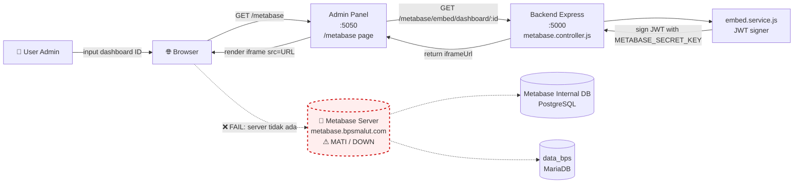
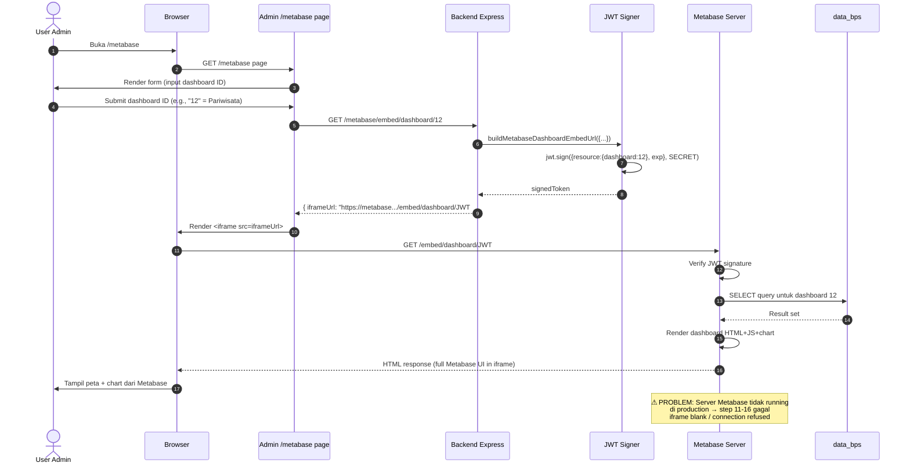
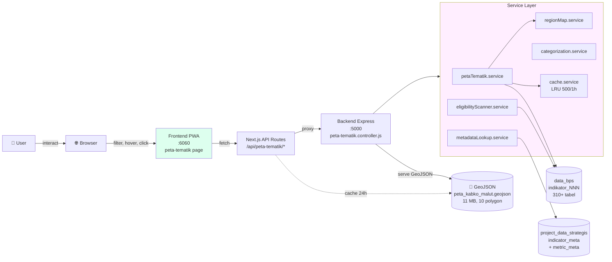
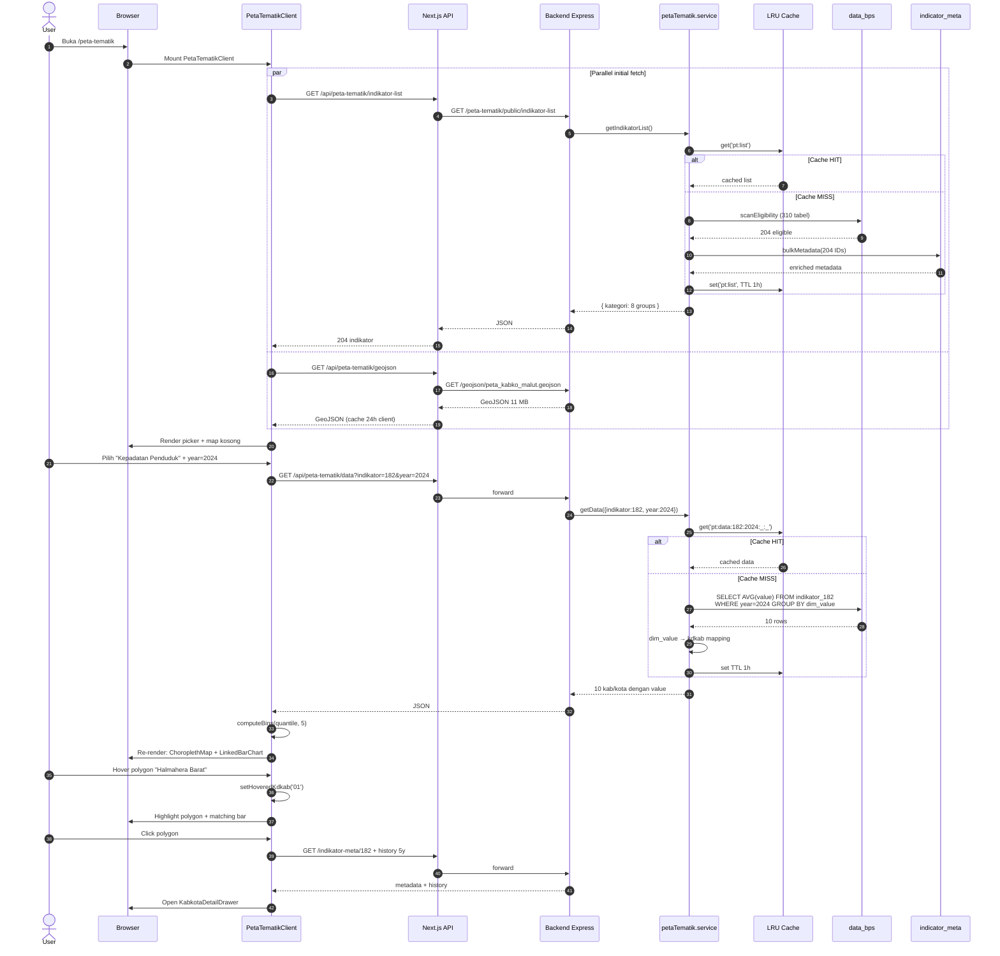
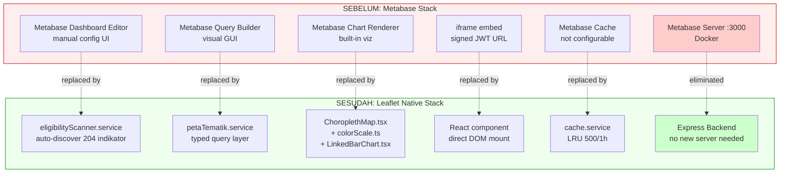

# Migrasi Peta Tematik: Metabase → Leaflet

> **Konteks**: Fitur peta tematik MALIKA bertransformasi dari **iframe embed Metabase dengan 2 indikator** (Perdagangan Luar Negeri + Pariwisata) menjadi **native Leaflet stack dengan 204 indikator** dari seluruh BPS Maluku Utara.
> **Tanggal migrasi**: design spec 2026-05-06, produksi tercapai Mei 2026.
> **Companion doc**: [`ARSITEKTUR_LENGKAP.md`](./ARSITEKTUR_LENGKAP.md).

---

## 1. Ringkasan Perubahan

| Aspek | **SEBELUM** (Metabase) | **SESUDAH** (Leaflet) |
|---|---|---|
| **Cakupan indikator** | 2 (Perdagangan Luar Negeri, Pariwisata) | **204** (semua eligible BPS Malut) |
| **Rendering** | `<iframe>` ke server Metabase | Native React component (Leaflet) |
| **External dependency** | Server Metabase upstream (Docker) | ❌ Tidak ada |
| **JWT signing** | ✅ Required (signed embed URL) | ❌ Tidak perlu |
| **Customization UI** | Terbatas template Metabase | Penuh (palette, drawer, linked chart, history) |
| **Status produksi** | ⚠ Non-fungsional (server upstream mati) | ✅ Production |
| **Caching** | Cache Metabase internal (tidak terkontrol) | LRU 500/1h di-control penuh |
| **Latency** | Network → Metabase server → render iframe | Backend service → JSON → render lokal |
| **Maintenance burden** | Maintain instance Metabase + dashboard config | Maintain kode aplikasi saja |

---

## 2. Diagram SEBELUM — Metabase Flow

### 2.1 Arsitektur sistem (sebelum)



### 2.2 Sequence flow (sebelum — happy path hipotetis)



### 2.3 Cakupan indikator (sebelum)

```
┌─────────────────────────────────────────────────────────┐
│  METABASE DASHBOARD INVENTORY                            │
├─────────────────────────────────────────────────────────┤
│                                                          │
│  📊 Dashboard #1: Perdagangan Luar Negeri (EXIM)        │
│     ├─ Sumber: indikator_159, indikator_160             │
│     ├─ Visual: peta + bar chart export/import           │
│     └─ Maintained manually di Metabase admin UI         │
│                                                          │
│  📊 Dashboard #2: Pariwisata                            │
│     ├─ Sumber: indikator_XXX (TPK Hotel, kunjungan)     │
│     ├─ Visual: peta + line chart                        │
│     └─ Maintained manually di Metabase admin UI         │
│                                                          │
│  ❌ 200+ indikator BPS lain: TIDAK terjangkau           │
│     (butuh manual create dashboard per indikator)        │
└─────────────────────────────────────────────────────────┘
```

### 2.4 Pain points sebelum

| Masalah | Dampak |
|---|---|
| Server Metabase upstream tidak running | Iframe blank di production → fitur 100% non-fungsional |
| Hanya 2 indikator yang ter-cover | 200+ indikator BPS lain tidak ada visualisasi spatial |
| Tiap indikator baru → manual create dashboard di Metabase | Scaling effort linear; tidak praktis |
| JWT secret + Metabase URL di env | Tambah surface configuration |
| Iframe = sandbox terisolasi | Tidak bisa linked-hover dengan komponen lain di page |
| Look & feel Metabase | Tidak konsisten dengan branding admin MALIKA |
| Tidak ada cache control | Latency tergantung Metabase server |

---

## 3. Diagram SESUDAH — Leaflet Native Flow

### 3.1 Arsitektur sistem (sesudah)



### 3.2 Sequence flow (sesudah — load + interaksi)



<p align="center"><strong>Gambar 3.4</strong> Tangkapan layar proses pengolahan data — audit kelayakan basis data dan pemetaan kanonik wilayah</p>

### 3.3 Cakupan indikator (sesudah)

```
┌─────────────────────────────────────────────────────────────┐
│  AUTO-DISCOVERED INDIKATOR INVENTORY (eligibility scan)     │
├─────────────────────────────────────────────────────────────┤
│  Total tabel BPS:           311  indikator_*                │
│  Excluded blacklist:          3  (indikator_418, 159, 160)  │
│  ───────────────────────────────────────────                │
│  ✅ ELIGIBLE (10 kab/kota): 204  indikator                  │
│                                                              │
│  Distribusi per kategori (auto-classified):                 │
│  ├─ Ekonomi                  ~45                            │
│  ├─ Kependudukan             26                             │
│  ├─ Ketenagakerjaan           6                             │
│  ├─ Pendidikan               14                             │
│  ├─ Kesehatan                ~30                            │
│  ├─ Pariwisata & Akomodasi   ~15                            │
│  ├─ Pembangunan & Sosial     ~40                            │
│  └─ Lainnya (catch-all)      ~28                            │
│                                                              │
│  ⚙ Self-healing: indikator BPS baru otomatis muncul        │
│    pada scan berikutnya (TTL 1 jam atau restart backend)    │
└─────────────────────────────────────────────────────────────┘
```

> Catatan: angka per kategori adalah perkiraan dari audit 2026-05-06. Detail eksak per indikator ada di [`INDIKATOR_DAFTAR.md`](./INDIKATOR_DAFTAR.md).

### 3.4 Keuntungan sesudah

| Yang Diperoleh | Mekanisme |
|---|---|
| **Cakupan 100× lebih luas** | 2 → 204 indikator via eligibility scan otomatis |
| **Self-healing untuk indikator baru** | Boot-time scanner + TTL 1h, no manual dashboard config |
| **Latency lebih konsisten** | LRU cache 1h di-control penuh, no external dependency |
| **UI editorial-grade** | Native React → palette custom + linked drawer + history rank |
| **Linked interaction** | Hover map ↔ hover chart (impossible di iframe Metabase) |
| **Shareable URL** | URL state persistence: `?indikator=X&year=Y&palette=Z` |
| **No external server** | Hapus dependency Docker Metabase + maintenance burden |
| **Semantic search** | 768-dim vector cosine, <50ms — fitur baru yang Metabase tidak punya |

---

## 4. Diagram Side-by-Side: Komponen Mapping

Mapping konseptual: apa di Metabase → apa di Leaflet?



---

## 5. Yang Berubah dari Perspektif User

### Skenario: User ingin lihat sebaran "Tingkat Penghunian Hotel" per kab/kota

#### SEBELUM (Metabase)
```
1. Buka /metabase                                        [klik]
2. Cari/input dashboard ID "Pariwisata" (e.g., 12)        [manual lookup]
3. Submit                                                 [klik]
4. Backend sign JWT                                       [~50ms]
5. Browser load iframe                                    [~2-3 detik]
6. Metabase server render dashboard                      [~3-5 detik]
   └─ ⚠ JIKA SERVER MATI: blank / connection refused
7. Tampil peta + chart dari Metabase
8. Tidak bisa drill-down per kab (terbatas iframe)
9. Tidak bisa ganti palette
10. Tidak bisa share URL spesifik (URL = embed JWT, expired)
```
**Total**: ~5-8 detik (jika server hidup); **gagal total** jika mati.

#### SESUDAH (Leaflet)
```
1. Buka /peta-tematik                                    [klik]
2. Cari di command palette "TPK hotel" atau scroll       [<50ms semantic search]
3. Pilih → URL update otomatis                           [instant]
4. PWA fetch /data + /summary parallel                   [~100-300ms, sering cache hit]
5. Map render dengan quantile 5-bin                      [<100ms]
6. Hover bar → polygon highlight (linked)                [instant, no fetch]
7. Click polygon → drawer history 5 tahun + ranking      [~200ms]
8. Ganti palette ke "Emerald" → URL update               [<50ms, no fetch]
9. Copy URL → share ke kolega → reproducible 100%        [instant]
```
**Total**: ~300-500ms; **selalu jalan** (no external dep).

---

## 6. Yang Berubah dari Perspektif Engineer

| Tugas | SEBELUM | SESUDAH |
|---|---|---|
| **Tambah indikator baru** | Login Metabase → create dashboard → add card → config viz → publish | Otomatis (ETL tambah tabel `indikator_NNN`, scan picks up dalam 1h) |
| **Ganti palette warna** | Tidak mungkin (Metabase locked theme) | Edit `colorScale.ts`, rebuild, deploy |
| **Tambah filter bulan** | Edit dashboard di Metabase UI | Sudah ada (otomatis tampil jika `has_monthly`) |
| **Debug data salah** | Cek query di Metabase admin + cek raw data | `tail -f` log backend + inspect cache + curl API |
| **Hosting** | Maintain instance Metabase (Docker, upgrade, backup) | Tidak ada — sudah di stack existing |
| **Secret management** | `METABASE_SECRET_KEY`, `METABASE_SITE_URL` di `.env` | Tidak ada secret peta-tematik di env |
| **Test coverage** | Praktis tidak ada (UI Metabase) | Unit tests untuk service + cache + region map + E2E Playwright |
| **Audit access** | Log Metabase server | Log Express backend (rate-limited public endpoint) |

---

## 7. Status Kode Metabase Saat Ini

Meskipun fungsi peta tematik sudah pindah, kode Metabase **belum dihapus** (soft deprecation):

```
backend/admin/app/metabase/page.tsx              ← page UI (masih live, non-fungsional)
backend/src/services/metabase/embed.service.js   ← JWT signer (idle)
backend/src/controllers/metabase.controller.js   ← controller (idle)
backend/src/routes/metabase.routes.js            ← /metabase/embed/dashboard/:id (live)
```

Endpoint `/metabase/embed/dashboard/:id` masih terdaftar di Express → masih bisa di-call → tapi return JWT yang point ke server mati. **Rekomendasi**: cleanup PR setelah 1-2 bulan stabil untuk hapus 4 file di atas.

---

## 8. Lampiran — Diagram ASCII Sederhana

Untuk yang prefer ASCII over Mermaid:

### SEBELUM
```
┌──────┐   ┌─────────┐   ┌─────────┐   ┌──────────┐   ┌──────────────┐
│ User │──▶│ Browser │──▶│ Admin   │──▶│ Backend  │──▶│ JWT Signer   │
└──────┘   └─────────┘   │/metabase│   │/metabase │   │embed.service │
                         └─────────┘   │/embed/:id│   └──────┬───────┘
                              ▲        └──────────┘          │
                              │                              │
                              │     ┌──── iframe URL ────────┘
                              │     ▼
                              │  ┌──────────────────────────┐
                              └──┤  Metabase Server :3000   │ ⚠ MATI
                                 │  (Docker, eksternal)     │
                                 └──────────┬───────────────┘
                                            ▼
                                     ┌──────────────┐
                                     │  data_bps    │
                                     │  (2 dashboard│
                                     │   only)      │
                                     └──────────────┘

Cakupan: 2 indikator (Perdagangan Luar Negeri, Pariwisata)
Status: NON-FUNGSIONAL di production
```

### SESUDAH
```
┌──────┐   ┌─────────┐   ┌───────────────┐   ┌─────────────────┐
│ User │──▶│ Browser │──▶│ PWA           │──▶│ Next.js API     │
└──────┘   └─────────┘   │/peta-tematik  │   │/api/peta-tematik│
                         │PetaTematik    │   └────────┬────────┘
                         │Client.tsx     │            │
                         │+ Leaflet      │            ▼
                         └───────────────┘   ┌─────────────────┐
                              ▲              │ Backend Express │
                              │              │ controllers/    │
                              │              │ peta-tematik    │
                              │              └────────┬────────┘
                              │                       │
                              │                       ▼
                              │            ┌──────────────────────┐
                              │            │ Service Layer:       │
                              │            │ ├─ petaTematik       │
                              │            │ ├─ regionMap         │
                              │            │ ├─ categorization    │
                              │            │ ├─ eligibilityScanner│
                              │            │ ├─ metadataLookup    │
                              │            │ └─ cache (LRU 1h)    │
                              │            └──────────┬───────────┘
                              │                       │
                              │       ┌───────────────┼────────────────┐
                              │       ▼               ▼                ▼
                              │  ┌─────────┐  ┌──────────────┐  ┌────────────┐
                              │  │GeoJSON  │  │  data_bps    │  │project_data│
                              │  │11MB     │  │  311 tabel   │  │_strategis  │
                              │  │10 poly  │  │  (204 eligi- │  │indicator_  │
                              │  └─────────┘  │   ble auto-  │  │meta + 768d │
                              │               │   discovered)│  │embedding   │
                              │               └──────────────┘  └────────────┘
                              │
                              └── Linked hover, drawer, history, palette
                                  share URL, semantic search, embed code

Cakupan: 204 indikator (semua kategori BPS Malut eligible)
Status: PRODUCTION
```

---

## 9. Timeline Migrasi

```
2026-05-06  📝 Design spec ditulis (docs/superpowers/specs/2026-05-06-peta-tematik-design.md)
            └─ Audit 311 tabel BPS → 204 eligible terdeteksi

2026-05-06  📋 Decision: pindah dari Metabase ke Leaflet native
            └─ Alasan: Metabase server upstream non-fungsional + scaling

2026-05-?? 🔨 Implementasi backend service layer
            ├─ eligibilityScanner.service.js
            ├─ petaTematik.service.js
            ├─ regionMap.service.js
            ├─ categorization.service.js
            └─ cache.service.js

2026-05-?? 🔨 Implementasi frontend
            ├─ ChoroplethMap.tsx (Leaflet + react-leaflet 4.2.1)
            ├─ colorScale.ts (5 palette editorial)
            ├─ LinkedBarChart.tsx
            ├─ KabkotaDetailDrawer.tsx
            └─ useUrlState.ts

2026-05-?? 🚀 Deploy production
            └─ Page /peta-tematik live, /metabase dibiarkan idle

2026-05-07  📦 Commit ff1ba33: "expand detail drawer with rich BPS metadata"
            └─ Drawer iterasi (metadata + history + ranking)

2026-05-17  📚 Dokumen migrasi ini ditulis

Belum  🧹  Cleanup kode Metabase (4 file masih ada)
```

---

## 10. Referensi

- [`ARSITEKTUR_LENGKAP.md`](./ARSITEKTUR_LENGKAP.md) — bedah arsitektur peta tematik baru
- [`INDIKATOR_DAFTAR.md`](./INDIKATOR_DAFTAR.md) — audit per-indikator (full/partial/empty)
- [`docs/superpowers/specs/2026-05-06-peta-tematik-design.md`](../superpowers/specs/2026-05-06-peta-tematik-design.md) — design spec original
- [`docs/memory/peta_tematik_palettes.md`](../memory/peta_tematik_palettes.md) — rationale palette editorial
- [`docs/memory/peta_tematik_kdkab.md`](../memory/peta_tematik_kdkab.md) — kdkab swap warning

---

## Change Log

| Tanggal | Penulis | Perubahan |
|---|---|---|
| 2026-05-17 | Claude (Opus 4.7) | Dokumen awal — diagram migrasi Metabase → Leaflet |
